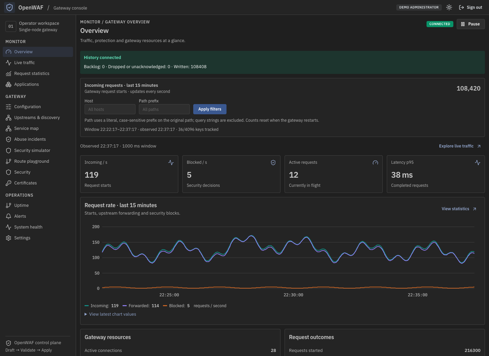
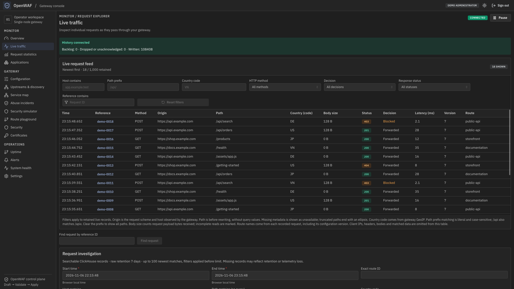
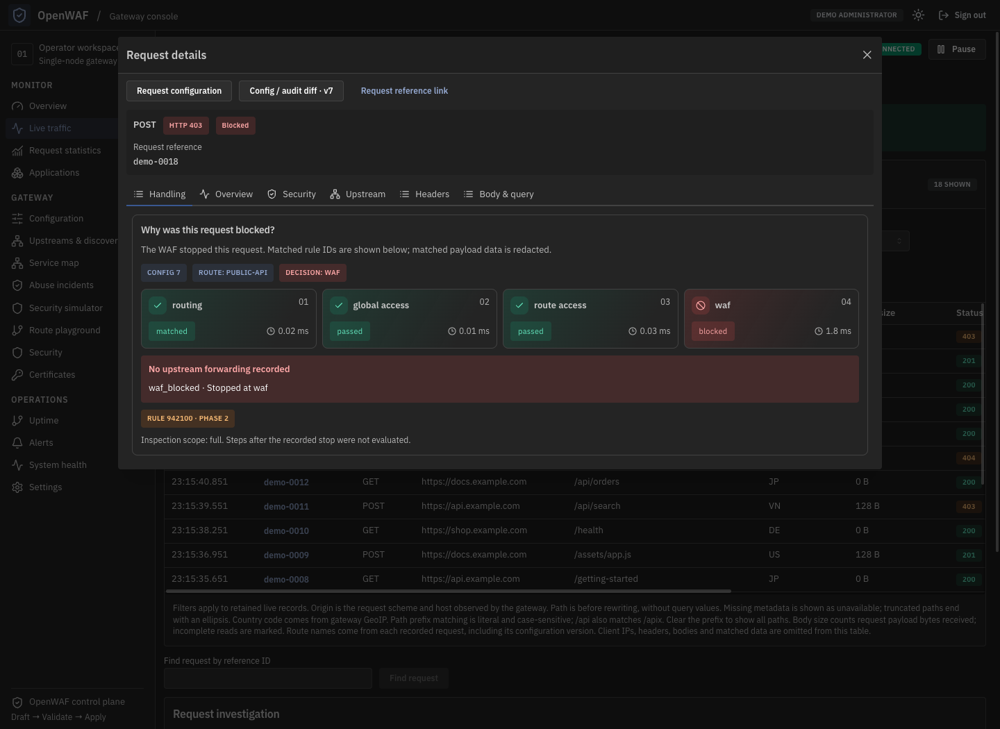
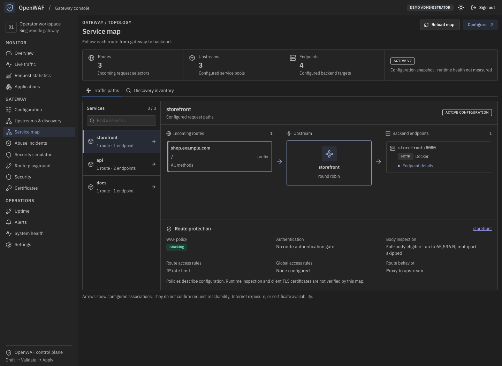
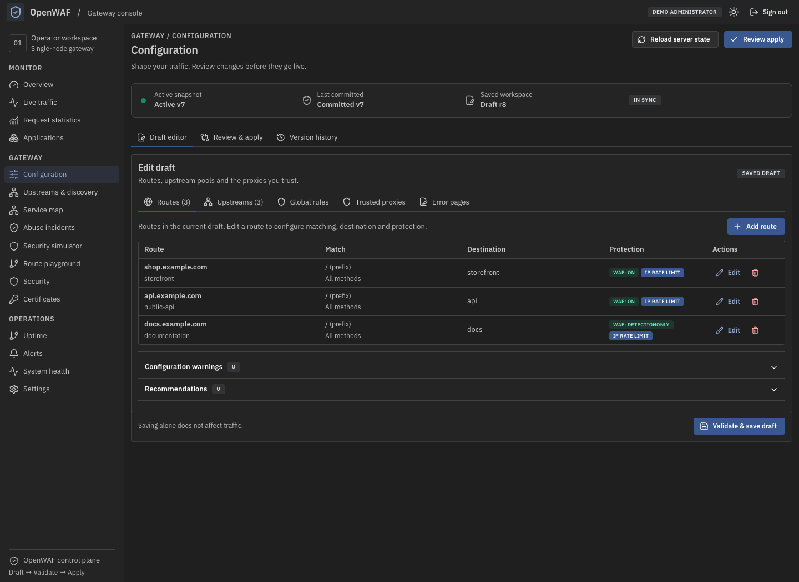
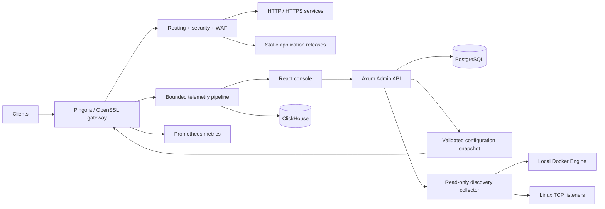

# OpenWAF

**A self-hosted web application firewall, reverse proxy, and realtime monitoring console for a single Linux node.**

OpenWAF brings traffic routing, request protection, TLS certificates, and operational visibility into one dashboard. Discover services running on your host or in Docker, choose and test an upstream, then review configuration changes before applying them to the gateway.

Built with **Rust, Pingora, ModSecurity, and OWASP CRS**, with a **React + TypeScript** console.

[Screenshots](#screenshots) · [Features](#features) · [Getting started](#getting-started) · [Development](#development) · [Documentation](#documentation)

> OpenWAF is under active development. See the [current plan](plan.md) for implementation status, open validation gates, and deferred work. Performance and production readiness depend on deployment-specific verification.

## Screenshots

Captured from the current frontend running locally with synthetic API and realtime data. Domains, services, configuration versions, and metrics are illustrative; these images are not production measurements or evidence of backend validation.

### Gateway overview

Monitor incoming requests, security blocks, latency, gateway resources, and history storage status.



### Live traffic

Follow individual requests as they arrive, filter retained records, and compare response statuses, security decisions, latency, and routes.



### Request details

Inspect a request's recorded handling steps, decision layer, configuration version, and matched WAF rule IDs. This example illustrates a request blocked before upstream forwarding.



### Service map

Follow configured routes through upstream pools to backend endpoints, with route protection and discovery metadata in context.



### Configuration workspace

Edit a draft, review changes, and track active configuration versions in one workspace.



## Features

- **Reverse proxy and routing.** Host, path, and method matching; HTTP/HTTPS upstreams; load balancing; health checks; DNS refresh; route middleware; and explicit traffic budgets. Downstream HTTP/1.1 and HTTP/2, with HTTP/1.1 upstream connections.
- **Web application firewall.** ModSecurity v3 with OWASP Core Rule Set, per-route policies and exclusions, and `Off`, `DetectionOnly`, or `On` modes. New policies default to detection only at paranoia level 1.
- **Layered request protection.** IP access rules, GeoIP controls, rate limits, HTTP flood limits, browser challenges, ForwardAuth, password-protected routes, and optional CrowdSec ban synchronization.
- **TLS and certificates.** Certificate inventory and reload, ACME HTTP-01 and Cloudflare DNS-01 workflows, plus Cloudflare provider and DNS management. Upstream certificate verification is enabled by default.
- **Local service discovery.** Read-only Docker and host TCP listener inventory, source timestamps, availability reasons, and gateway-side connection tests. Discovery suggests endpoints; operators select the protocol and validate changes before applying them.
- **Traffic visibility and investigation.** Realtime charts and live requests, request details, service maps, statistics, endpoint diagnostics, uptime views, and system health. ClickHouse stores traffic history; Prometheus supplies metrics history when configured.
- **Versioned configuration.** Draft → validate → review → apply, with diffs, audit records, atomic snapshot publication, and validated rollback. In-flight requests retain their original snapshot.
- **Static frontend applications.** Serve prebuilt static sites or SPAs uploaded as ZIP releases, with preview and activation controls.

The console supports light and dark themes, pause/resume, and explicit stale, gap, and loss indicators. Client retention is bounded to 1,000 live logs and 15 minutes of chart samples.

## Architecture



The gateway reads prepared snapshots and local security state. Database queries, discovery collection, and CrowdSec synchronization stay outside the proxy hot path. Only the discovery collector receives access to the Docker socket. Slow dashboard clients and unavailable traffic storage must not block proxy traffic.

| Component | Technology |
| --- | --- |
| Gateway and TLS | Rust, Pingora, OpenSSL, `instant-acme` |
| WAF | libmodsecurity v3, OWASP CRS |
| Admin API and background workers | Axum, Tokio |
| Configuration and administration | PostgreSQL, SQLx |
| Traffic history and metrics | ClickHouse, Prometheus |
| Docker discovery | `bollard`, separate local collector |
| Dashboard | React, TypeScript, Vite, Mantine |
| Frontend data and visualization | TanStack Query, React Hook Form, D3 + Canvas |

## Getting started

### Deploy on a Linux VPS

Use the maintained [Ansible deployment guide](deploy/ansible/README.md) and [fresh VPS walkthrough](docs/fresh-deploy-vps.md). Deployment runs over SSH, prepares Docker and persistent host storage, pulls release images, and checks bootstrap and HTTPS readiness. Rust and Node.js are not required on the VPS.

Before deploying, prepare:

1. A Linux VPS with SSH and root/sudo access, and a Linux/macOS controller with Python 3.11+.
2. Published gateway and initializer images from the same release, pinned to a specific tag or digest.
3. A Cloudflare-managed domain and a scoped API token supplied through a private file outside the checkout.
4. Restricted access to the admin hostname and origin before first setup. The current bootstrap allows the first visitor to create the administrator; the deployment guide describes the required access controls.

Follow the guide to configure inventory, private inputs, DNS, and certificate issuance. There is no default administrator account. Keep persistent data and encryption master keys backed up separately; complete backup/restore tooling remains deferred.

### Build container images

The [image build guide](build/README.md) describes the build and publication workflow. From the repository root, build both images using the configured registry, release tag, and target platform:

```sh
docker compose -f build/compose.yaml build
```

The gateway image packages the Rust runtime, dashboard, and CRS. A separate one-shot initializer image prepares deployment state. Deployment pulls these images; it does not compile source on the VPS.

## Development

### Backend

Native builds require Rust 1.88+, a C/C++ toolchain, CMake, pkg-config, OpenSSL development files, libmodsecurity 3.0.9+, and OWASP CRS. See the [backend guide](backend/README.md) for environment configuration, native rule paths, and managed or standalone execution.

```sh
make -C backend build
make -C backend check
```

`check` runs formatting checks, Clippy, and workspace tests. Integration scenarios and deployment acceptance require their own environments.

### Frontend

Use Node.js 24 and npm. Configure trusted local HTTPS certificates and an Admin API target as described in the [frontend guide](frontend/README.md), then run:

```sh
cd frontend
npm ci
npm run dev
```

The development server uses `https://localhost:5173` and proxies API requests to the configured Admin API. The default API target is `http://127.0.0.1:9090`; the Admin origin must match the frontend HTTPS origin.

```sh
npm run lint
npm run typecheck
npm run format:check
npm run build
```

## Scope and current limits

OpenWAF targets one Linux node with one local administrator. Multi-node/HA, multi-tenancy, remote Docker management, HTTP/3, and CDN caching are outside the MVP. Static application hosting accepts built assets; backend application runtimes, source builds, SSR, and container deployment are outside scope.

WAF coverage depends on the route profile, body type, and configured inspection budget. Response bodies and WebSocket frames are not inspected. Review the [current plan](plan.md) and [operational contract](docs/operations.md) before enabling blocking for uploads, streams, or other specialized workloads. ACME lifecycle, sustained traffic, reload continuity, and recovery need deployment-specific evidence; the screenshots do not establish those guarantees.

## Documentation

| Topic | Guide |
| --- | --- |
| Status, architecture, and roadmap | [Current plan](plan.md) |
| Deployment and operations | [Ansible](deploy/ansible/README.md) · [Fresh VPS setup](docs/fresh-deploy-vps.md) · [Runbook](docs/deployment-runbook.md) |
| Image builds | [Build guide](build/README.md) |
| Source development | [Backend](backend/README.md) · [Frontend](frontend/README.md) |
| Routing and traffic controls | [Operations](docs/operations.md) · [Middleware](docs/route-middleware.md) |
| Protection | [Global rules](docs/global-rules.md) · [HTTP flood protection](docs/ddos-protection.md) · [Anti-abuse](docs/anti-abuse.md) |
| Monitoring and investigation | [Statistics](docs/request-statistics.md) · [Request details](docs/request-details.md) · [Investigation](docs/investigation.md) |
| Certificates and applications | [Certificates](docs/certificates.md) · [Cloudflare](docs/cloudflare-providers.md) · [Applications](docs/applications.md) |

Most detailed project guides are currently written in Vietnamese.
